# Comparative Analysis of 4-Bit Ripple-Carry Adders (90 nm CMOS)

[](https://www.cadence.com)
[](https://www.cadence.com)
[-2ea44f.svg)]()
[]()
[](LICENSE)

Transistor-level design, schematic capture, Spectre simulation, and comparative power–delay–complexity evaluation of **4-bit Ripple-Carry Adders (RCA)** implemented in **Static CMOS**, **Clocked CMOS ($\text{C}^2\text{MOS}$)**, and **Domino Dynamic Logic** at the **90 nm CMOS (`gpdk090`)** technology node ($V_{DD} = 1.0\text{ V}$).

> **Case Study Report:** [`report/case_study.pdf`](report/case_study.pdf) · **Detailed Analysis:** [`analysis/comparative_analysis.md`](analysis/comparative_analysis.md) · **Technical Audit:** [`analysis/technical_audit.md`](analysis/technical_audit.md)

---

## Key Findings & Benchmark Summary

In this study, **Domino dynamic logic** serves as the focal technique for high-speed, compact carry-path evaluation and is benchmarked against unclocked **Static CMOS** and complementary-clocked **$\text{C}^2\text{MOS}$** realizations of the same four-stage RCA architecture.

| Logic Family | Devices / FA (PMOS / NMOS) | 4-Bit Total Devices | Clocking Scheme | Calculator Delay ($t_{pd}$) | Average Power ($P_{avg}$) | Power-Delay Product (PDP) | Transient Timing / Vector Notes |
| :--- | :---: | :---: | :--- | :---: | :---: | :---: | :--- |
| **Static CMOS** | 28 (14P / 14N) | 112 | Unclocked | $251.81\text{ ps}$ | **$13.25\ \mu\text{W}$** *(Lowest)* | **$3.34\text{ fJ}$** *(Best)* | $C_{in}\!\to C_{out}$: $248\text{ ps}$; $C_{in}\!\to S_3$: $265\text{ ps}$ |
| **$\text{C}^2\text{MOS}$** | 32 (16P / 16N) | 128 | Complementary clocks (`clk`, `clkb`, 2 ns period) | $260.75\text{ ps}$ | $29.49\ \mu\text{W}$ | $7.69\text{ fJ}$ | $A=1011_2\ (11)$, $B=1100_2\ (12) \to 23 / 24$ |
| **Domino Logic** | **26** (11P / 15N) | **104** *(Lowest)* | Single clock (`clk`, precharge/evaluate) | **$222.35\text{ ps}$** *(Fastest)* | $30.76\ \mu\text{W}$ | $6.84\text{ fJ}$ | $A=0111_2\ (7)$, $B=1000_2\ (8) \to 15 / 16$ ($C_{in}\!\to S_2$: $232\text{ ps}$) |

**Central Engineering Insight:**
A compact dynamic cell and a low-power implementation are **not synonymous**. Although Domino achieves the **lowest per-cell transistor count** (`26` MOSFETs/FA; `104` total) and the **lowest calculator delay** (`222.35 ps`, **11.7% faster** than Static CMOS and **14.7% faster** than $\text{C}^2\text{MOS}$), cyclic precharge/evaluation switching yields the **highest average power** (`30.76 µW`, $2.32\times$ Static CMOS). Unclocked **Static CMOS** leads on both **average power (`13.25 µW`)** and **PDP (`3.34 fJ`)**—achieving a **51.2% lower PDP** than Domino (`6.84 fJ`) and **56.6% lower PDP** than $\text{C}^2\text{MOS}$ (`7.69 fJ`).

<p align="center">
  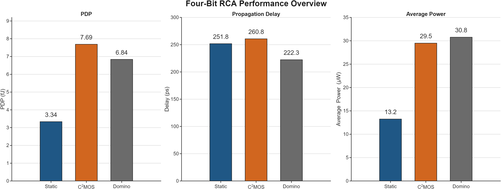
</p>

<details>
<summary><strong>View Individual Metric Charts &amp; Exact PDP Verification</strong></summary>

$$\mathrm{PDP}\ (\mathrm{fJ}) = \frac{P_{avg}\ (\mu\mathrm{W}) \times t_{pd}\ (\mathrm{ps})}{1000}$$

* **Static CMOS:** $13.25 \times 251.81 / 1000 = 3.3365\text{ fJ} \rightarrow \mathbf{3.34\text{ fJ}}$
* **$\text{C}^2\text{MOS}$:** $29.49 \times 260.75 / 1000 = 7.6895\text{ fJ} \rightarrow \mathbf{7.69\text{ fJ}}$
* **Domino Logic:** $30.76 \times 222.35 / 1000 = 6.8395\text{ fJ} \rightarrow \mathbf{6.84\text{ fJ}}$

| Power-Delay Product | Propagation Delay | Average Power |
| :---: | :---: | :---: |
| 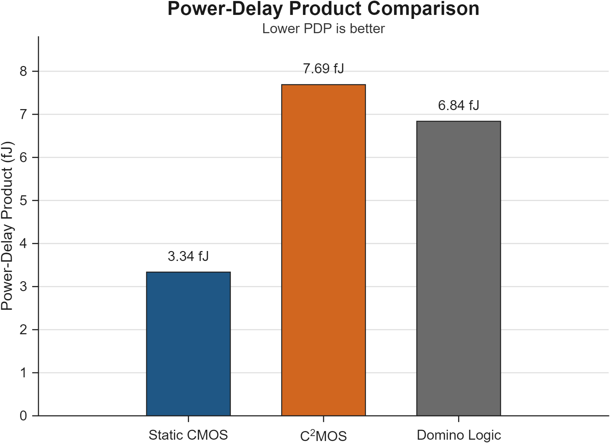 | 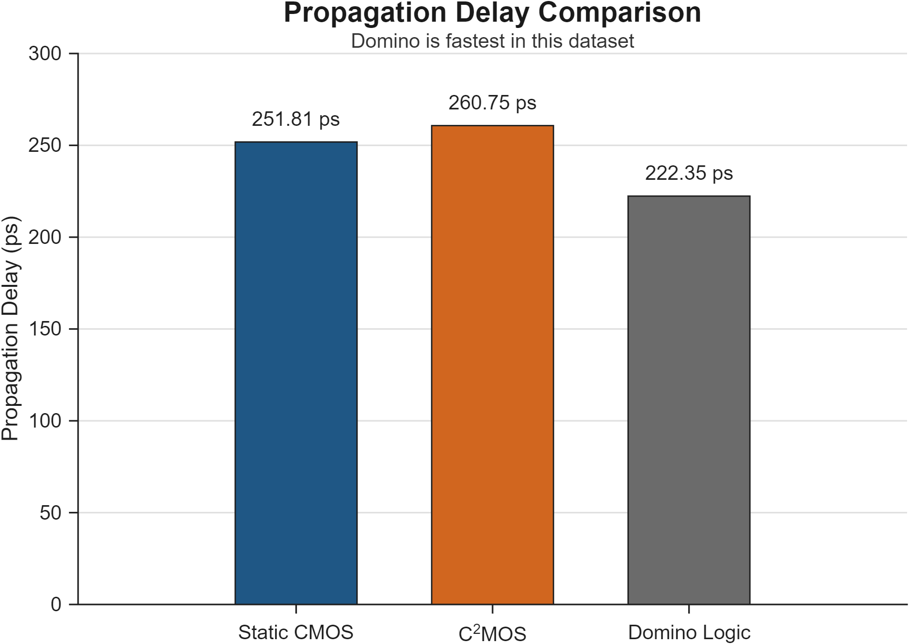 | 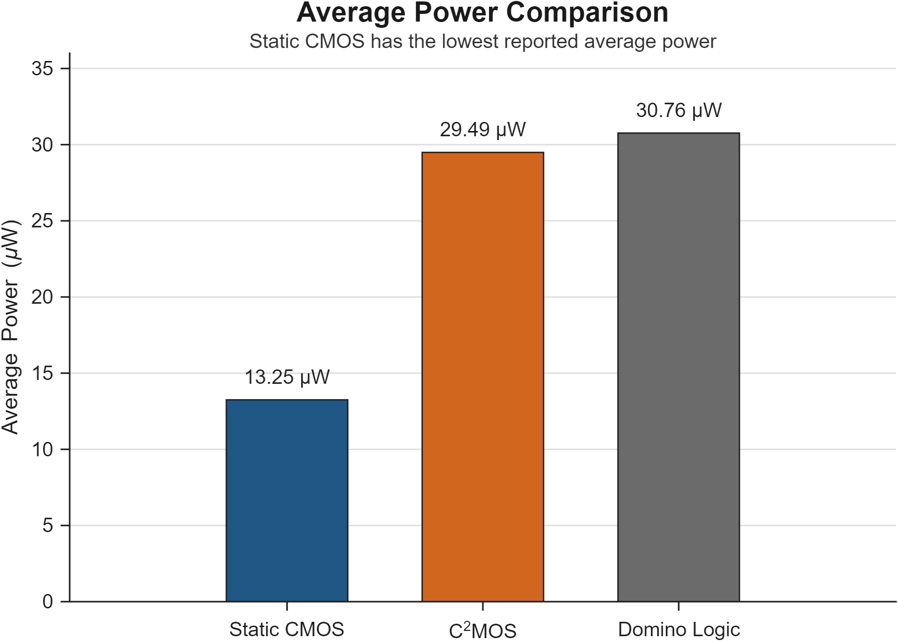 |

</details>

---

## Architecture & Transistor-Level Organization

Each 1-bit full adder computes sum $S_i$ and carry-out $C_{i+1}$ from operand bits $A_i, B_i$ and incoming carry $C_i$:

$$P_i = A_i \oplus B_i, \qquad G_i = A_i B_i, \qquad S_i = P_i \oplus C_i, \qquad C_{i+1} = G_i + P_i C_i$$

Cascading four identical stages connects $C_{i+1}$ of slice $i$ to $C_i$ of slice $i+1$ ($C_0 = C_{in}$, final carry $C_4 = C_{out}$):

```
(A0, B0, Cin) ──► [ FA0 ] ──► S0, C1 ──► [ FA1 ] ──► S1, C2 ──► [ FA2 ] ──► S2, C3 ──► [ FA3 ] ──► S3, Cout
```

### Logic Family Implementations (`cadence/rca_all_designs.sp`)

1. **Static CMOS (`FA_STATIC` — 28T Mirror Topology):**
   Complementary PMOS pull-up (PUN) and NMOS pull-down (PDN) networks with static output inverters for `sum` and `cout`. Delivers full rail-to-rail output restoration and requires no evaluation clock.
2. **$\text{C}^2\text{MOS}$ (`FA_C2MOS` — 32T Clock-Gated Topology):**
   Adds anti-phase clock-gating transistors (`clk`, `clkb`) in series with both the carry (`14T`) and sum (`18T`) mirror stages, holding output logic states during the non-evaluating phase at the cost of higher transistor count and clock capacitance.
3. **Domino Logic (`FA_DOMINO` — 26T Footed Dynamic Topology):**
   Separates the cell into a **10T footed dynamic carry cone** (PMOS precharge `Mp_cpre`, weak PMOS keeper `Mp_ckp` at $W = 100\text{ nm}$ against 90 nm subthreshold leakage, NMOS evaluation tree, NMOS footer `Mn_cfoot`, and monotonic static inverter) and a **16T sum stage** fed by the internal dynamic node `dyn_cout`.

---

## Cadence Virtuoso Schematics

All nine Cadence Virtuoso Schematic Editor captures (1-bit full adder cells, 4-stage hierarchical RCA chains, and simulation testbenches) are archived under [`assets/schematics/`](assets/schematics/).

### 1. Static CMOS (`FA_STATIC` / `RCA4_STATIC` / `tb_rca4_static`)

| 1-Bit Full Adder (28T) | 4-Bit Ripple-Carry Adder (112T) | Simulation Testbench |
| :---: | :---: | :---: |
| 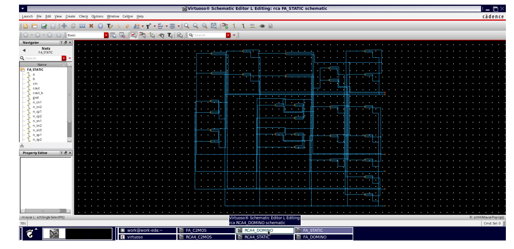 | 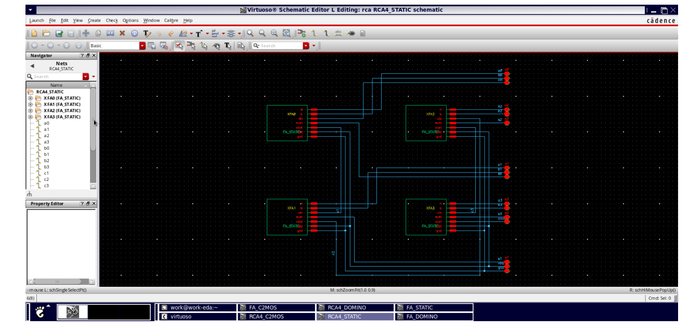 | 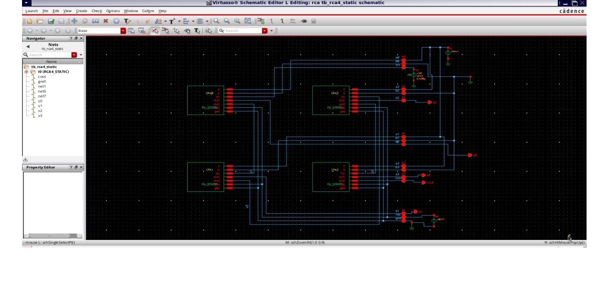 |

### 2. $\text{C}^2\text{MOS}$ (`FA_C2MOS` / `RCA4_C2MOS` / `tb_rca4_c2mos`)

| 1-Bit Full Adder (32T) | 4-Bit Ripple-Carry Adder (128T) | Simulation Testbench |
| :---: | :---: | :---: |
| 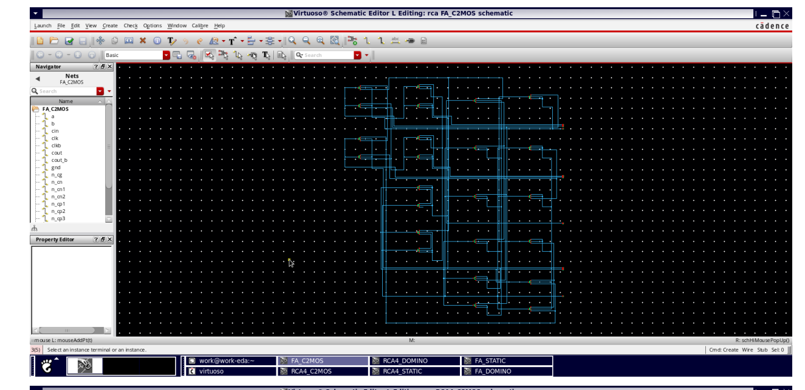 | 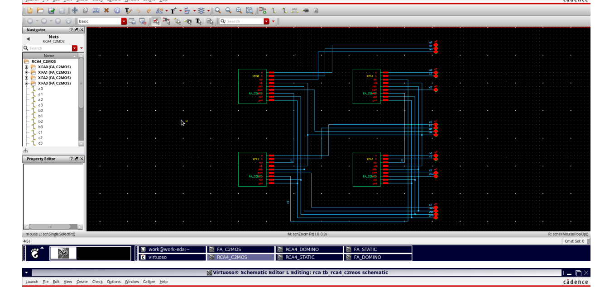 | 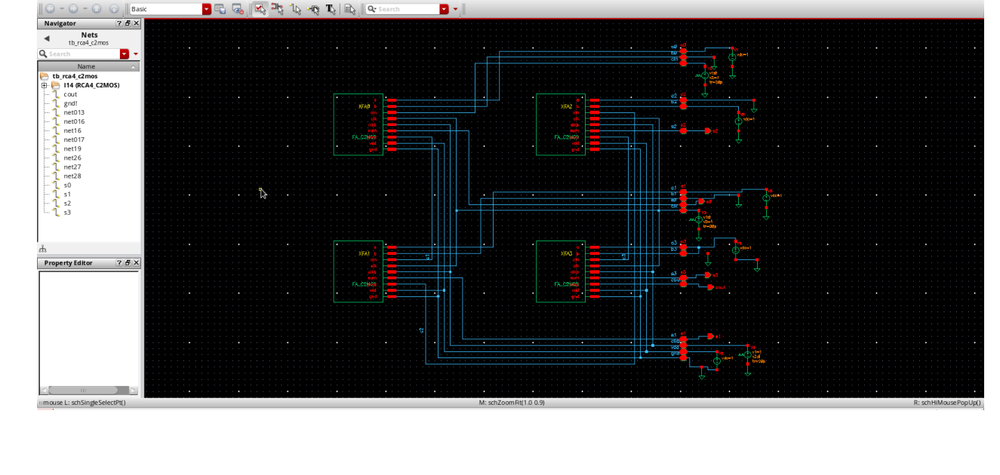 |

### 3. Domino Logic (`FA_DOMINO` / `RCA4_DOMINO` / `tb_rca4_domino`)

| 1-Bit Full Adder (26T) | 4-Bit Ripple-Carry Adder (104T) | Simulation Testbench |
| :---: | :---: | :---: |
| 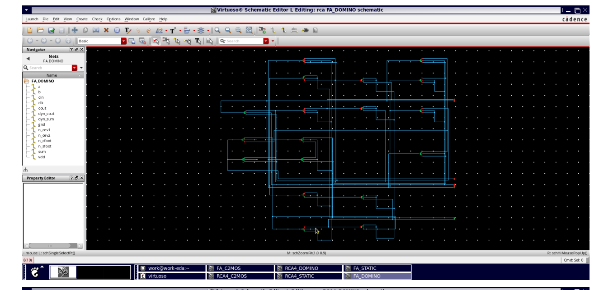 | 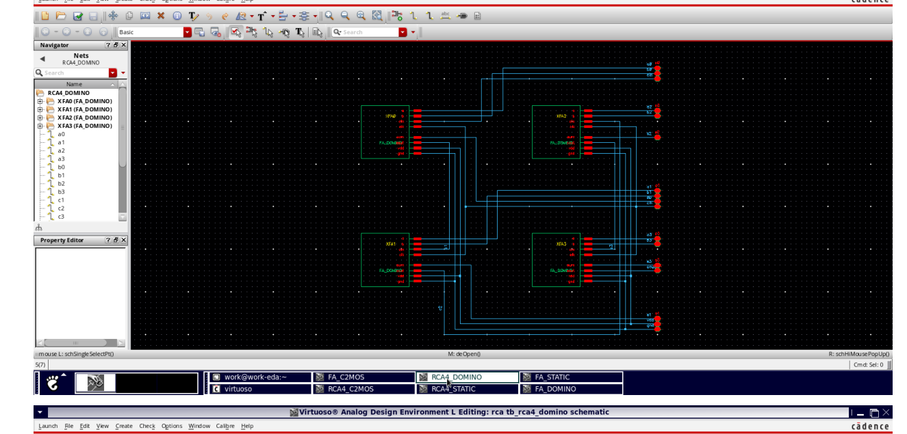 | 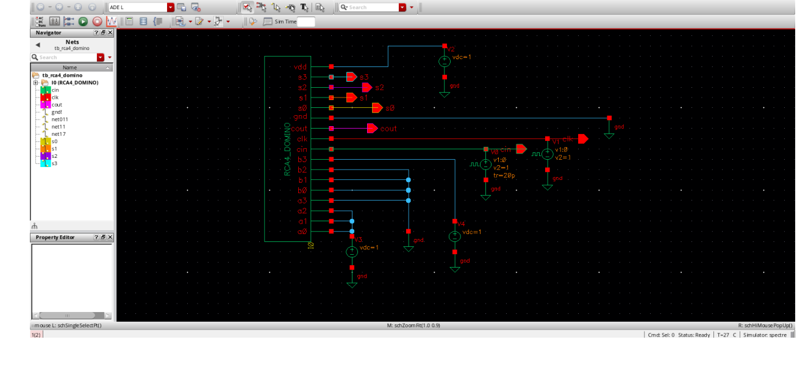 |

---

## Simulation Waveforms & Functional Verification

### Static CMOS Transient Response & Carry-Ripple Progression
* **Multi-Cycle Transient (`static_output_waveforms.png`):** Demonstrates clean rail-to-rail switching across `s0–s3` and `cout` synchronized to periodic `cin` transitions.
* **Single-Step Carry Ripple (`static_carry_ripple_step.jpg`):** Captures the sequential carry propagation staircase from $C_{in}$ rising at `1.000 ns` through `s0` ($\approx 80\text{ ps}$), `s1` ($\approx 148\text{ ps}$), `s2` ($\approx 212\text{ ps}$), `cout` (**$248\text{ ps}$**), and `s3` (**$265\text{ ps}$**).

| Multi-Cycle ViVA Output | Zoomed Single-Step Carry-Ripple Staircase |
| :---: | :---: |
| 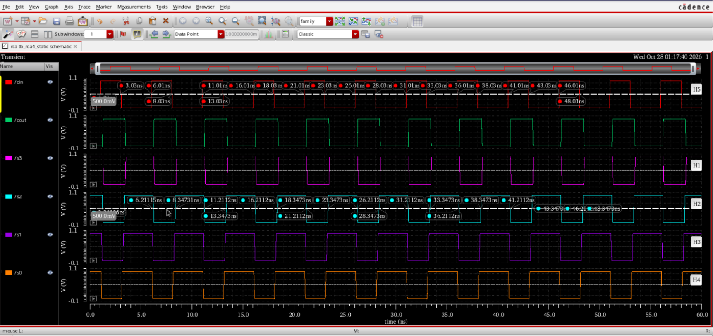 | 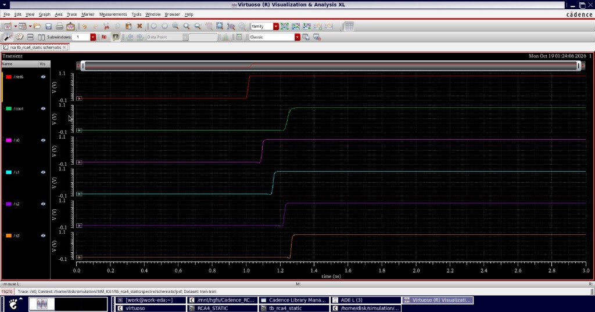 |

### $\text{C}^2\text{MOS}$ Functional Verification ($A = 1011_2 = 11$, $B = 1100_2 = 12$, $500\text{ MHz}$ Clocks)
* **$C_{in} = 0$ (`0–10 ns`, `20–30 ns`):** $\{C_{out}, S_3, S_2, S_1, S_0\} = 10111_2 = 23_{10}$
* **$C_{in} = 1$ (`10–20 ns`, `30–40 ns`):** $\{C_{out}, S_3, S_2, S_1, S_0\} = 11000_2 = 24_{10}$

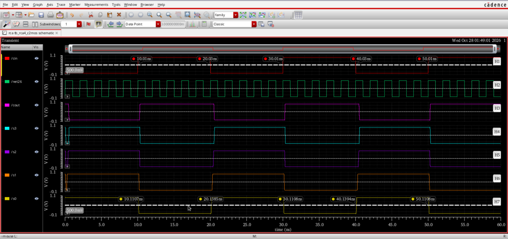

### Domino Logic Carry-Propagate Verification ($A = 0111_2 = 7$, $B = 1000_2 = 8$, All $P_i = 1$)
* **$C_{in} = 0$ (Evaluate `clk = 1`):** $\{C_{out}, S_3, S_2, S_1, S_0\} = 01111_2 = 15_{10}$
* **$C_{in} = 1$ (Evaluate `clk = 1`):** $\{C_{out}, S_3, S_2, S_1, S_0\} = 10000_2 = 16_{10}$, forcing carry propagation through every bit slice ($C_{in} \to S_2$ annotated at **$232\text{ ps}$**).

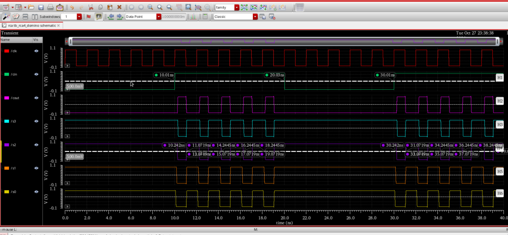

---

## Methodological Scope & Engineering Caveats

To interpret this dataset rigorously (see [`analysis/technical_audit.md`](analysis/technical_audit.md)):
* **Schematic-Level Simulation:** Reported values reflect pre-layout schematic simulations in `gpdk090` (`1.0 V`) without post-layout parasitic RC extraction, PVT corner sweeps, or Monte Carlo variation.
* **Test Vector & Clock Scope:** The captured $\text{C}^2\text{MOS}$ and Domino waveforms evaluate different functional vectors (`11 + 12` vs. `7 + 8`), and Static CMOS's multi-cycle waveform operand pattern is unannotated. Aggregate average power includes clock and precharge activity without isolating clock-tree vs. datapath switching energy.
* **PDP Definition:** Reported PDPs are computed directly from $P_{avg} \cdot t_{pd} / 1000$ rather than integrating $V_{DD}I_{DD}(t)\,dt$ across an isolated addition window.

---

## Repository Structure

```text
rca-4bit-cadence-90nm/
├── README.md                              # Project documentation, visuals, and reproduction guide
├── LICENSE                                # MIT License
├── CITATION.cff                           # Machine-readable citation metadata
│
├── cadence/                               # Cadence Virtuoso IC6.1.7 & Spectre (gpdk090) suite
│   ├── rca_all_designs.sp                 # Verified netlist (FA_STATIC 28T, FA_C2MOS 32T, FA_DOMINO 26T)
│   ├── devmap_gpdk090.map                 # GPDK090 CDL/SPICE device mapping
│   ├── devmap_analogLib.map               # Generic analogLib device mapping
│   ├── model_alias.scs                    # Spectre model alias definitions for gpdk090
│   ├── fix_symbols.il                     # SKILL script: standardized schematic symbol generator
│   ├── create_all_testbenches.il          # SKILL script: automated testbench builder
│   └── testbenches/                       # Standalone Spectre simulation decks (.scs)
│       ├── tb_rca4_static.scs
│       ├── tb_rca4_c2mos.scs
│       └── tb_rca4_domino.scs
│
├── assets/                                # Cadence captures & publication-grade charts
│   ├── schematics/{static,c2mos,domino}/  # 1-bit FA, 4-bit RCA, and testbench schematics (9 PNGs)
│   ├── waveforms/                         # Cadence ViVA transient waveforms & carry-ripple step
│   └── plots/                             # MATLAB/Python comparison figures (PNG + vector PDF)
│
├── analysis/                              # Written analysis, literature synthesis, and plot scripts
│   ├── comparative_analysis.md            # Architecture, waveform, and trade-off deep dive
│   ├── technical_audit.md                 # Netlist verification, arithmetic checks, and scope caveats
│   ├── literature_review.md               # Synthesis of 12 peer-reviewed adder/CMOS studies
│   ├── metrics_summary.csv                # Machine-readable benchmark dataset
│   └── scripts/                           # Reproducible plot generators (.m and .py)
│
├── report/                                # Formal Case Study Deliverable
│   ├── case_study.pdf                     # Final 17-page VLSI System Design Case Study report
│   └── latex/                             # Editable LaTeX source & BibTeX bibliography
│
└── standalone_simulation/                 # Optional open-source Ngspice + PTM 90nm harness
    ├── README.md
    ├── runner.py
    ├── models/ptm_90nm.pm
    └── netlists/
```

---

## Reproducing the Workflow

### 1. Cadence Virtuoso & Spectre (`gpdk090`)
1. Launch Cadence Virtuoso in a working directory configured with `gpdk090` (`cds.lib`), and create library `rca` attached to technology library `gpdk090`.
2. Import [`cadence/rca_all_designs.sp`](cadence/rca_all_designs.sp) via **File → Import → CDL / SPICE** using device map [`cadence/devmap_gpdk090.map`](cadence/devmap_gpdk090.map) and reference libraries `gpdk090 analogLib basic`.
3. Generate standardized left-to-right symbols and schematic testbenches from the Virtuoso CIW:
   ```lisp
   load("/path/to/cadence/fix_symbols.il")
   load("/path/to/cadence/create_all_testbenches.il")
   ```
4. Alternatively, run batch Spectre simulations directly from [`cadence/testbenches/`](cadence/testbenches/) after adjusting the `gpdk090.scs` PDK include path:
   ```bash
   spectre tb_rca4_static.scs
   spectre tb_rca4_c2mos.scs
   spectre tb_rca4_domino.scs
   ```

### 2. Regenerating Performance Plots & Report PDF
* **Python (Matplotlib):**
  ```bash
  python analysis/scripts/generate_performance_plots.py
  ```
* **MATLAB:**
  ```matlab
  run('analysis/scripts/generate_performance_plots.m')
  ```
* **LaTeX Case Study PDF (Tectonic):**
  ```bash
  cd report/latex && tectonic --outdir .. main.tex
  ```

### 3. Open-Source `ngspice` Quick Check (No Cadence License Required)
See [`standalone_simulation/README.md`](standalone_simulation/README.md) for running the PTM 90 nm BSIM4 verification harness.

---

## Author

* **Saksham Arora** (`24BEC0185`) — [@Saksham-239](https://github.com/Saksham-239) — *VLSI System Design Lab, School of Electronics Engineering (SENSE), Vellore Institute of Technology (VIT), Vellore*

---

## License & Citation

This project is released under the [MIT License](LICENSE). If you reference the schematics, netlists, or case study analysis, please cite [`CITATION.cff`](CITATION.cff) or use:

```bibtex
@misc{arora2026rca90nm,
  author       = {Arora, Saksham},
  title        = {Comparative Analysis of 4-Bit Ripple-Carry Adders: Static CMOS, C2MOS, and Domino Logic in 90nm CMOS},
  year         = {2026},
  howpublished = {\url{https://github.com/Saksham-239/rca-4bit-cadence-90nm}},
  note         = {VLSI System Design Lab Case Study}
}
```
