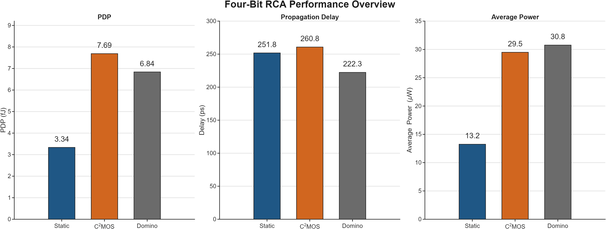

# Comparative Circuit & Performance Analysis

This document synthesizes the transistor-level architecture, transient functional verification, and Cadence Virtuoso (`gpdk090`, $V_{DD} = 1.0\text{ V}$) benchmark results for the three **4-bit Ripple-Carry Adder (RCA)** implementations evaluated in this repository.

---

## 1. Arithmetic & Architectural Baseline

A 1-bit Full Adder (FA) computes sum $S_i$ and carry-out $C_{i+1}$ from inputs $A_i$, $B_i$, and incoming carry $C_i$ using propagate ($P_i$) and generate ($G_i$) signals:

$$P_i = A_i \oplus B_i, \qquad G_i = A_i B_i$$

$$S_i = P_i \oplus C_i, \qquad C_{i+1} = G_i + P_i C_i = A_i B_i + C_i(A_i \oplus B_i)$$

Four identical FA cells are cascaded into a 4-bit Ripple-Carry Adder (`RCA4_*`), connecting $C_{i+1}$ of stage $i$ to $C_i$ of stage $i+1$ ($C_0 = C_{in}$, final carry $C_4 = C_{out}$). Because a carry-propagate chain ($P_i = 1$) must traverse all four bit slices sequentially, the RCA exposes how each CMOS logic style trades off critical-path delay, switching capacitance, clocking overhead, and transistor complexity.

---

## 2. Quantitative Benchmark Summary (Cadence Virtuoso `gpdk090`, 1.0 V)

| Metric | Static CMOS | $\text{C}^2\text{MOS}$ | Domino Logic | Best in Dataset |
| :--- | :---: | :---: | :---: | :--- |
| **Devices per 1-Bit FA** | 28 (14P, 14N) | 32 (16P, 16N) | **26** (11P, 15N) | **Domino Logic** |
| **Total Devices (4-Bit RCA)** | 112 MOSFETs | 128 MOSFETs | **104 MOSFETs** | **Domino Logic** |
| **Relative Device Overhead vs. Domino** | +7.7% (28 vs. 26) | +23.1% (32 vs. 26) | Baseline (26 / FA; 7.1% fewer than Static, 18.8% fewer than $\text{C}^2\text{MOS}$) | **Domino Logic** |
| **Clocking Scheme** | Unclocked (static combinational) | Complementary clocks (`clk`, `clkb`, 2 ns period / 500 MHz) | Single precharge/evaluate clock (`clk`) | Static (zero clock load) |
| **Reported Calculator Delay ($t_{pd}$)** | $251.81\text{ ps}$ | $260.75\text{ ps}$ | **$222.35\text{ ps}$** | **Domino Logic** |
| **Reported Average Power ($P_{avg}$)** | **$13.25\ \mu\text{W}$** | $29.49\ \mu\text{W}$ | $30.76\ \mu\text{W}$ | **Static CMOS** |
| **Power-Delay Product ($\text{PDP} = P_{avg} \cdot t_{pd}$)** | **$3.34\text{ fJ}$** | $7.69\text{ fJ}$ | $6.84\text{ fJ}$ | **Static CMOS** |
| **Observed Transient Timing** | $C_{in}\!\to C_{out}$: $248\text{ ps}$ $C_{in}\!\to S_3$: $265\text{ ps}$ | Clocked transitions across $C_{in}$ intervals | $C_{in}\!\to S_2$: $232\text{ ps}$ | — |

*Note: Domino reduces per-cell MOSFET count by **7.1%** relative to Static CMOS (26 vs. 28) and **18.8%** relative to $\text{C}^2\text{MOS}$ (26 vs. 32).*

---

## 3. Logic-Style Deep Dive

### A. Static CMOS (`FA_STATIC` — 28T Mirror Topology)
* **Organization:** Uses complementary PMOS pull-up networks (PUN) and NMOS pull-down networks (PDN) with inverting output buffers (`cout_b -> cout`, `sum_b -> sum`).
* **Strengths:** Full rail-to-rail output restoration ($V_{OH} = V_{DD},\ V_{OL} = 0\text{ V}$), straightforward combinational cascading with zero clock load, and **lowest average power ($13.25\ \mu\text{W}$)** and **lowest PDP ($3.34\text{ fJ}$)** across the dataset.
* **Trade-offs:** Series PMOS stacks in the PUN and full complementary gate capacitance yield a slower evaluation path (`251.81 ps` calculator delay; `248 ps` $C_{in} \to C_{out}$ and `265 ps` $C_{in} \to S_3$ in the single-step carry-ripple trace).

### B. $\text{C}^2\text{MOS}$ (`FA_C2MOS` — 32T Clock-Gated Topology)
* **Organization:** Inserts clock-controlled PMOS (`clkb`) and NMOS (`clk`) gating transistors into both the carry (`14T`) and sum (`18T`) mirror stages, holding the output state during the non-evaluating phase.
* **Functional Verification:** Evaluated at $500\text{ MHz}$ ($T = 2\text{ ns}$) with $A = 1011_2\ (11_{10})$ and $B = 1100_2\ (12_{10})$:
  * $C_{in} = 0 \implies \{C_{out}, S_3, S_2, S_1, S_0\} = 10111_2 = 23_{10}$
  * $C_{in} = 1 \implies \{C_{out}, S_3, S_2, S_1, S_0\} = 11000_2 = 24_{10}$
* **Trade-offs:** Highest transistor count (`32T/FA`, `128T` total) and highest calculator delay (`260.75 ps`) and PDP (`7.69 fJ`) in this dataset, driven by series clock-gating stacks and complementary clock switching capacitance ($29.49\ \mu\text{W}$).

### C. Domino Logic (`FA_DOMINO` — 26T Footed Dynamic Topology)
* **Organization:** Combines a **10-transistor footed dynamic carry cone** (PMOS precharge `Mp_cpre`, weak PMOS keeper `Mp_ckp` at $W=100\text{ nm}$ to combat subthreshold leakage at 90 nm, NMOS carry evaluation network, NMOS clock footer `Mn_cfoot`, and static inverter) with a **16-transistor sum stage** fed by the internal complementary carry node `dyn_cout`.
* **Functional Verification:** Evaluated with $A = 0111_2\ (7_{10})$ and $B = 1000_2\ (8_{10})$, setting all four propagate terms $P_i = A_i \oplus B_i = 1$:
  * $C_{in} = 0 \implies \{C_{out}, S_3, S_2, S_1, S_0\} = 01111_2 = 15_{10}$ during evaluation (`clk = 1`)
  * $C_{in} = 1 \implies \{C_{out}, S_3, S_2, S_1, S_0\} = 10000_2 = 16_{10}$ during evaluation (`clk = 1`)
  * Annotated propagation from $C_{in}$ to $S_2$: `232 ps` (`10.010 ns` $\to$ `10.242 ns`).
* **Trade-offs:** Achieves the **lowest calculator delay ($222.35\text{ ps}$)** (11.7% faster than Static CMOS, 14.7% faster than $\text{C}^2\text{MOS}$) and **lowest cell transistor count (`26T/FA`, `104T` total)**. However, cyclic precharge/evaluate switching results in the **highest average power ($30.76\ \mu\text{W}$, $2.32\times$ Static CMOS)** and a **PDP of $6.84\text{ fJ}$ ($2.05\times$ Static CMOS)**.

---

## 4. Key Engineering Takeaways

1. **Compact Dynamic Cell $\neq$ Low-Power Implementation:** Domino uses the fewest transistors per FA (`26T` vs. `28T` Static / `32T` $\text{C}^2\text{MOS}$) and achieves the fastest response (`222.35 ps`), yet consumes the highest average power (`30.76 µW`) because dynamic nodes precharge and evaluate on every clock cycle.
2. **Energy-Delay Dominance of Static CMOS in Unpipelined RCAs:** Without a clock network or cyclic precharge overhead, Static CMOS maintains a **51.2% lower PDP** (`3.34 fJ`) than Domino (`6.84 fJ`) and **56.6% lower PDP** than $\text{C}^2\text{MOS}$ (`7.69 fJ`).
3. **Design Selection Criterion:**
   * Choose **Static CMOS** for lowest power, lowest PDP, full noise immunity, and unclocked operation.
   * Choose **Domino Logic** when critical-path delay minimization (`222.35 ps`) and compact cell footprint outweigh clock/precharge energy and keeper/charge-sharing sensitivity.
   * Choose **$\text{C}^2\text{MOS}$** when phase-controlled clocked sequencing or latched datapath integration is specifically required.
